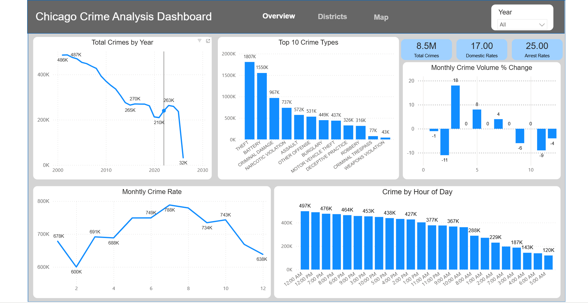

# Chicago Crime Analysis Dashboard

What drives crime in Chicago, and where and when does it happen? This project analyzes **8.5 million** reported crimes from the City of Chicago's open data portal (2001 to 2026), cleans and models them in SQL Server, and visualizes them in an interactive, three-page Power BI dashboard (Overview, Districts, Map).

[](https://app.powerbi.com/view?r=eyJrIjoiZjM5NjcyZWQtOWEwZi00NzVmLWI5ODgtZGZiMWQyYTA0OWM2IiwidCI6ImJjNGQ5MjI5LTgwODktNGE3Zi1iZjQwLTA0NTk0MDFlOWVkMiIsImMiOjJ9)

**[View the live Power BI dashboard](https://app.powerbi.com/view?r=eyJrIjoiZjM5NjcyZWQtOWEwZi00NzVmLWI5ODgtZGZiMWQyYTA0OWM2IiwidCI6ImJjNGQ5MjI5LTgwODktNGE3Zi1iZjQwLTA0NTk0MDFlOWVkMiIsImMiOjJ9)** (click the image or this link)

## Key Findings

- **Crime has fallen by more than half since the early 2000s**, from roughly 487K reported crimes a year to about 210K in 2021, before rebounding to around 263K.
- **Theft (1.8M) and battery (1.55M) dominate**, together making up about 40% of all reported crimes.
- **Crime peaks in summer.** July is the highest month (~788K across all years) and February the lowest (~600K).
- **About 25% of crimes lead to an arrest, and 17% are domestic-related.**
- **Midnight and noon are the top hours**, while early morning (5 to 6 AM) is the quietest.

## Tools

| Stage | Tool |
|---|---|
| Data cleaning | SQL Server (SSMS) |
| Analysis | SQL: CTEs, window functions (`RANK`, `ROW_NUMBER`, `LAG`, running totals), views |
| Visualization | Power BI (3 pages, year slicer, district drilldowns, map) |

## Pipeline

```
Chicago Data Portal (CSV)  →  SQL Server (clean + views)  →  Power BI
```

1. **Clean:** removed duplicate case numbers, standardized crime type names, flagged missing coordinates, dropped unused columns.
2. **Analyze:** built SQL views answering specific questions: yearly and monthly trends, month-over-month % change, top crime types, arrest and domestic rates, district rankings vs. the citywide average, and time-of-day patterns.
3. **Visualize:** Power BI connects to the views for the Overview, Districts, and Map pages.

## Repository Contents

| Folder / File | What's inside |
|---|---|
| `sql/01_data_cleaning.sql` | Deduplication and cleanup |
| `sql/02_overview_views.sql` | Trends, crime types, arrest/domestic rates, hour of day |
| `sql/03_district_views.sql` | District rankings, comparisons, map data |
| `screenshots/` | Dashboard images |
| `data/` | Data source info (the full dataset is too large for GitHub) |

## Data

The full dataset (~8.5M rows) is too large to store here. Download it from the City of Chicago Data Portal:
[Crimes - 2001 to Present](https://data.cityofchicago.org/Public-Safety/Crimes-2001-to-Present/ijzp-q8t2)

Note: 2026 is a partial year.

## How to Run

1. Download the CSV from the link above.
2. In SSMS, import it into a table named `crime_analysis` (Tasks → Import Flat File).
3. Run the files in `sql/` in order.
4. Connect Power BI to the database and use the views.

## Author

**Carl D. Pericles**: Marine Corps veteran and data analytics student (B.A.S., Data Analytics & AI, Broward College)
[LinkedIn](https://www.linkedin.com/in/carlpericles) · [GitHub](https://github.com/CarlPericles18)
